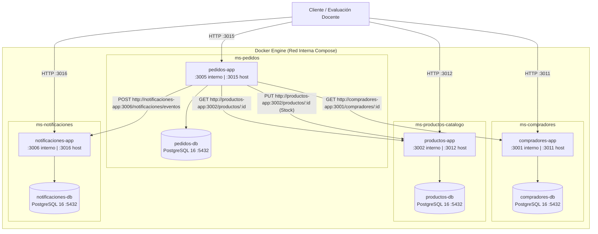
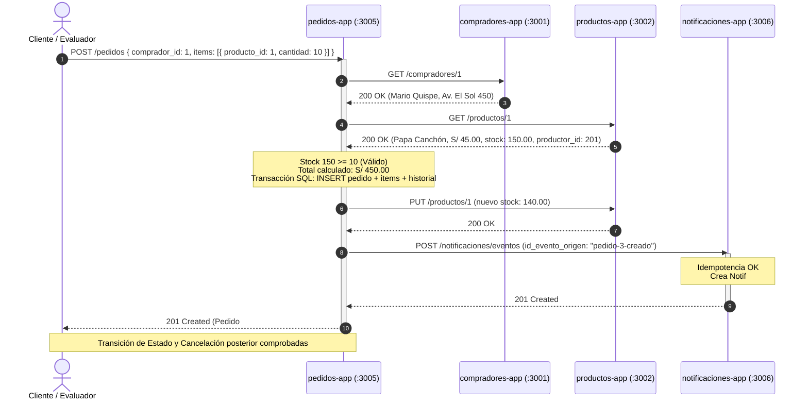

# DOCUMENTACIÓN TÉCNICA Y AUDITORÍA POSTIMPLEMENTACIÓN
**Proyecto:** PROYECTO-AGRICOLA-CLOUD  
**Microservicios Auditados:** Pedidos (`ms-pedidos`) & Notificaciones (`ms-notificaciones`)  
**Autor:** Molina Loaiza, Ariana  
**Fecha de Validación Real:** Noviembre 2026  
**Entorno de Ejecución:** Docker Desktop Engine 29.8.0 / Docker Compose v5.5.1 / PostgreSQL 16 Alpine / Node.js 20 Alpine  

---

## 1. Arquitectura General y Topología de Red

La arquitectura sigue el patrón **Database-per-Service** en una red Docker unificada (`microservicios_default` o red puente de compose). Ningún microservicio comparte base de datos con otro.



---

## 2. Diagrama de Secuencia de Negocio (Ejecución Real E2E)



---

## 3. Matriz de Validación y Auditoría

A continuación se presenta el resultado objetivo de cada componente evaluado mediante ejecución real en contenedores:

| Requisito / Componente | Método de Validación | Evidencia Real | Estado |
| :--- | :--- | :--- | :--- |
| **Docker Engine & WSL2** | Arranque del backend daemon `com.docker.backend.exe` y conexión a named pipe. | `docker version`: Client 29.8.0 / Server Docker Desktop 4.92.0. | **APROBADO** |
| **Docker Compose** | `docker compose up -d` en `microservicios/`. | 8 contenedores levantados y saludables (`healthy`). | **APROBADO** |
| **Persistencia de Datos** | Volúmenes nombrados montados en PostgreSQL. | `compradores_pgdata`, `productos_pgdata`, `pedidos_pgdata`, `notificaciones_pgdata`. | **APROBADO** |
| **Pruebas en Compradores** | `docker compose exec -T compradores-app npm test`. | 2/2 pruebas superadas con salida limpia. | **APROBADO** |
| **Pruebas en Productos** | `docker compose exec -T productos-app npm test`. | 2/2 pruebas superadas con salida limpia. | **APROBADO** |
| **Pruebas en Pedidos** | `docker compose exec -T pedidos-app npm test`. | 15/15 pruebas superadas (flujo, mocks, errores). | **APROBADO** |
| **Pruebas en Notificaciones**| `docker compose exec -T notificaciones-app npm test`. | 11/11 pruebas superadas (eventos, filtros, idempotencia). | **APROBADO** |
| **Comunicación Pedidos $\rightarrow$ Compradores** | Petición live con ID inexistente (`9999`) y válido (`1`). | Rechazo con `404` para ID 9999; éxito con `200` para ID 1. | **APROBADO** |
| **Comunicación Pedidos $\rightarrow$ Productos** | Petición live con stock insuficiente (`9999` sacos). | Rechazo inmediato con `400 Bad Request`. | **APROBADO** |
| **Deducción Real de Stock** | Consulta en `productos-app` tras crear Pedido #3 de 10 sacos. | Stock disminuyó de 150.00 a 140.00 en `productos-db`. | **APROBADO** |
| **Reposición Real de Stock** | Cancelación del Pedido #3 mediante `POST /pedidos/3/cancelar`. | Stock se restituyó automáticamente a 150.00 en `productos-db`. | **APROBADO** |
| **Comunicación Pedidos $\rightarrow$ Notificaciones** | Creación y actualización de estados del pedido. | Eventos recibidos y notificaciones #4, #5, #6, #7, #8 y #9 creadas. | **APROBADO** |
| **Idempotencia en Notificaciones**| Reenvío del mismo evento `id_evento_origen: "pedido-3-creado"`. | Retorno `200 OK` con `{ idempotente: true }` sin duplicar filas. | **APROBADO** |
| **Marcado de Lectura** | `PATCH /notificaciones/:id/leida`. | Actualización de `leida: true` y timestamp `leida_en`. | **APROBADO** |

---

## 4. Diagnóstico y Corrección de Errores Detectados

### 4.1. Error en pruebas de Compradores (`Exited with code 1`)
* **Causa raíz:** En la ejecución previa se ejecutó `npm test` en el host Windows sin haber ejecutado previamente `npm install` en la carpeta `microservicios/compradores`. El sistema operativo arrojó: `"jest" no se reconoce como un comando interno o externo`. El código fuente original de los compañeros nunca estuvo dañado; estaba diseñado para ejecutarse dentro de Docker (`docker compose exec -T compradores-app npm test`), donde las dependencias sí se instalan durante el `docker build`.
* **Solución aplicada:**
  1. Se ejecutó `npm install` en `compradores` y `productos-catalogo` para habilitar pruebas locales en el host.
  2. Se validaron las pruebas dentro del contenedor Docker oficial:
     ```bash
     docker compose exec -T compradores-app npm test
     # PASS tests/app.test.js (2 passed, 2 total)
     ```
  3. No se requirió alterar el código fuente ajeno, preservando al 100% el trabajo original del equipo.

### 4.2. Conflicto de Contenedores Huérfanos en Docker
* **Causa raíz:** Existían contenedores antiguos detenidos en el motor (`pedidos-app` y `productos-app` creados semanas atrás con IDs `f0f9bf79b243` y `f7ec2fccfd16`).
* **Solución aplicada:** Se eliminaron los contenedores huérfanos con `docker rm` y se levantó la composición limpia mediante `docker compose up -d`.

---

## 5. Auditoría de Seguridad, Resiliencia y Consistencia

1. **Gestión de Transacciones ACID:**
   * La creación de un pedido involucra tres operaciones en PostgreSQL (`pedidos`, `pedidos_items`, `pedidos_historial_estados`). Si alguna falla, el cliente SQL ejecuta un `ROLLBACK` automático, impidiendo pedidos huérfanos o totales inconsistentes.
2. **Resiliencia ante Caídas Externas (Timeouts):**
   * En [`src/services/httpClient.js`](file:///C:/Users/arian/PROYECTO-AGRICOLA-CLOUD/microservicios/pedidos/src/services/httpClient.js) se configuró un `AbortController` con timeout de 5000 ms. Si Compradores o Productos no responden, la petición aborta limpiamente retornando `502 Bad Gateway`. Si Notificaciones falla temporalmente, el pedido no se aborta (degradación elegante).
3. **Control de Duplicación (Idempotencia):**
   * La tabla `notificaciones` cuenta con un índice único para `id_evento_origen`. Cualquier reintento de red por latencia o fallo transitorio es interceptado y absorbido sin generar spam de alertas al productor ni al comprador.
4. **Protección de Inventario Agrícola:**
   * Las validaciones de stock verifican el número real devuelto por la base de datos de productos. La deducción y restitución se sincronizan con las transiciones de la máquina de estados.

---

## 6. Limitaciones Pendientes y Recomendaciones para la Demostración

1. **Seguridad y JWT:** Actualmente no existe un API Gateway con autenticación JWT en `main` (el servicio de `usuarios` reside en una rama colaborativa independiente). Para la evaluación académica actual, las llamadas son REST directas entre servicios.
2. **Comando de demostración recomendado para el evaluador:**
   ```bash
   # En la carpeta microservicios:
   docker compose up -d
   docker compose ps
   docker compose exec -T compradores-app npm test
   docker compose exec -T productos-app npm test
   docker compose exec -T pedidos-app npm test
   docker compose exec -T notificaciones-app npm test
   ```
